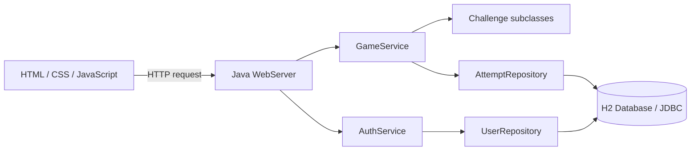
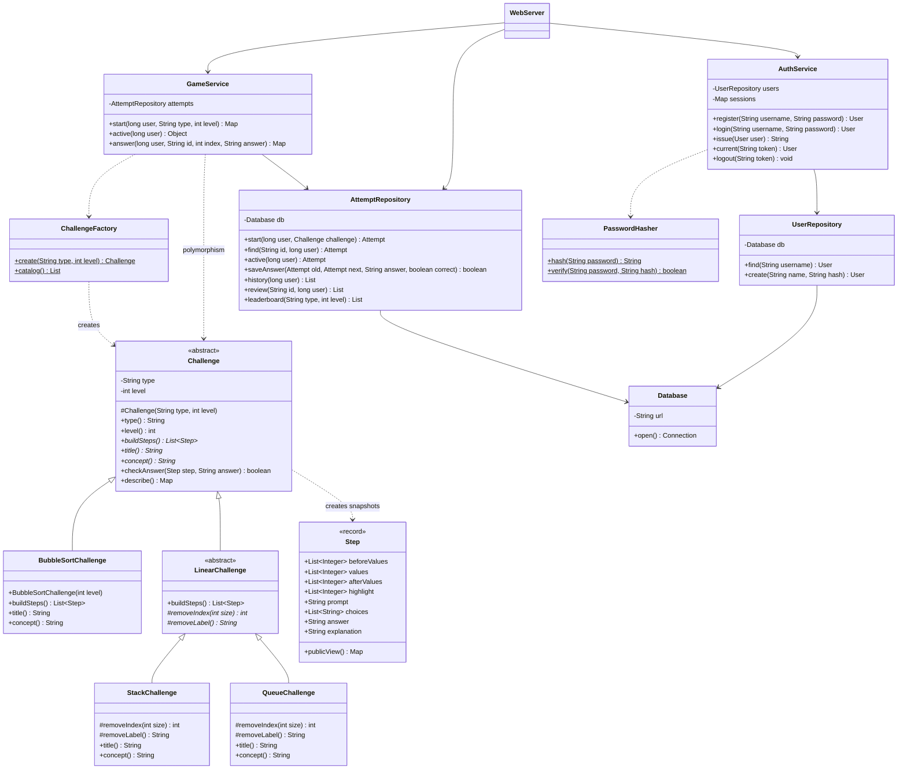
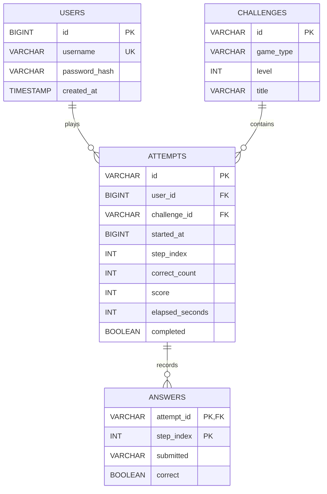

# แนวทางอธิบายโครงงาน Algorithm Arena

เอกสารนี้เป็นข้อมูลประกอบและโครงร่างรายงาน ไม่ใช่รายงานฉบับส่ง ชื่อผู้จัดทำ รหัสนักศึกษา อาจารย์ วันดำเนินงาน ปัญหาที่พบ และภาพการทดสอบต้องใช้ข้อมูลจริงของผู้จัดทำ

## ภาพรวมระบบ

ผู้เล่นเข้าสู่ระบบ เลือกด่าน และรับเฉพาะสถานะปัจจุบันจาก Java Server เมื่อเลือกคำตอบ Java ตรวจตามกติกาอัลกอริทึม คำนวณคะแนน และบันทึกในฐานข้อมูล H2 จากนั้นเว็บแสดงเฉลยและส่งผู้เล่นไปขั้นตอนต่อไป ข้อมูลเกมอยู่ที่เซิร์ฟเวอร์ ไม่เชื่อคะแนนที่ส่งจากเบราว์เซอร์ ภาพเคลื่อนไหวใช้ beforeValues เพื่อแสดงการเพิ่มข้อมูล และรับ transition.values หลังตอบเพื่อแสดงผลที่ถูกต้อง การเล่นภาพซ้ำไม่ส่งคำตอบหรือเปลี่ยนคะแนน



## Class Diagram



หมายเหตุ: แผนภาพเน้นคลาสสำคัญ ไม่แสดงทุกเมธอดย่อย `Step`, `User`, `Attempt` และ session เป็น record ที่ Java สร้าง constructor/accessor ให้ แต่ไม่มี setter `List.copyOf()` ใน `Step` ป้องกันภาพขั้นตอนเดิมเปลี่ยนเมื่ออัลกอริทึมแก้รายการต้นฉบับ

## ตัวอย่าง Polymorphism ที่ใช้จริง

```java
Challenge challenge = ChallengeFactory.create(type, level);
var steps = challenge.buildSteps();
```

ชนิดตัวแปรคือ `Challenge` แต่วัตถุจริงอาจเป็น `BubbleSortChallenge`, `StackChallenge` หรือ `QueueChallenge` การสร้างขั้นตอนเลือกตามวัตถุจริง ส่วน Stack และ Queue ใช้อัลกอริทึมสถานการณ์ร่วมกันใน `LinearChallenge` แล้วเปลี่ยนพฤติกรรม `removeIndex()` ให้เป็นตัวท้ายและตัวแรกตามลำดับ ไม่จำเป็นต้องเขียนทับ `checkAnswer()` หากการเทียบคำตอบใช้กติกาเดียวกัน

## ER Diagram



`started_at` เป็น Unix epoch หน่วยมิลลิวินาที ส่วน `elapsed_seconds` เป็นวินาที ค่า -1 หมายถึงรอบที่ถูกยุติเมื่อเริ่มรอบใหม่ `completed=true` ใช้บอกว่ารอบปิดแล้ว จึงต้องตรวจจำนวนขั้นตอนและ elapsed เพิ่มเพื่อแยกรอบที่เล่นจบจริง `answers` ใช้คีย์ร่วมของรอบและขั้นตอนเพื่อไม่ให้มีคำตอบซ้ำ

## อัลกอริทึมที่อธิบายในรายงานได้

### Bubble Sort

วนเปรียบเทียบสมาชิกติดกัน หากซ้ายมากกว่าขวาให้สลับ เมื่อครบหนึ่งรอบ ค่ามากที่สุดในส่วนที่ยังไม่เรียงจะอยู่ท้าย ลดขอบเขตด้านท้ายแล้วทำซ้ำ โค้ดใช้ nested loop แบบไม่หยุดก่อนเวลา จึงมี n(n-1)/2 การเปรียบเทียบ และใช้เวลา O(n²) สำหรับการเรียง ส่วนการบันทึก snapshot ทุกขั้นตอนเพิ่มต้นทุนการคัดลอกข้อมูล O(n) ต่อขั้นตอน ทำให้การสร้างโจทย์รวมใช้เวลา/พื้นที่ O(n³) ในเวอร์ชันนี้ (ขนาดโจทย์เล็ก)

### Stack และ Queue

`LinearChallenge` จำลองคำสั่งเพิ่มและนำข้อมูลออก แล้วถ่ายภาพสถานะก่อนการนำออก Stack เลือก index สุดท้าย ส่วน Queue เลือก index 0 การใช้งานนี้เก็บข้อมูลด้วย ArrayList การลบหน้าใน Queue จึงมี O(n) สำหรับเลื่อนสมาชิก อย่าอ้างว่าเป็น Queue ที่ลบได้ O(1) หากยังใช้โครงสร้างนี้

### การคิดคะแนน

`round(correctCount / totalSteps × 1000)` คำตอบผิดไม่เพิ่มจำนวนถูก ยังคงเดินต่อด้วยสถานะที่ถูกต้อง คะแนนจึงเทียบกันได้ภายในด่านเดียวกัน ตารางอันดับใช้ SQL window function เลือกผลดีที่สุดหนึ่งรายการต่อคน แล้วเรียงคะแนนมากไปน้อย เวลาน้อยไปมาก

## โครงร่างรายงานตามแนวตัวอย่าง

### บทที่ 1 ที่มาและความสำคัญ

- ปัญหา: การอ่านอัลกอริทึมเพียงอย่างเดียวอาจไม่ช่วยให้เห็นสถานะที่เปลี่ยนในแต่ละขั้น
- วัตถุประสงค์: สร้างเกมฝึกความเข้าใจ และประยุกต์ Java OOP กับฐานข้อมูล
- ขอบเขต: 3 สนาม 15 ด่าน ระบบสมาชิก ประวัติ และตารางอันดับ
- ประโยชน์และกลุ่มผู้ใช้: ผู้เริ่มเรียนอัลกอริทึม/โครงสร้างข้อมูล
- ตารางดำเนินงาน: ใส่วันที่ทำจริงของตนเอง

### บทที่ 2 การพัฒนา

- เครื่องมือ Java, JDK HttpServer, JDBC, H2, HTML/CSS/JavaScript
- การทำงานของระบบและหน้าจอ
- Class Diagram พร้อม attributes / methods / constructor
- ER Diagram และคำอธิบายตาราง
- ตัวอย่าง Constructor, Encapsulation, Abstraction, Inheritance, Overriding, Polymorphism
- อัลกอริทึมและสูตรคะแนน
- การทดสอบ: ขั้นตอน ข้อมูลนำเข้า ผลที่คาดหวัง ผลจริง และภาพหน้าจอ

### บทที่ 3 สรุป

- ผลที่ทำได้จริงตามขอบเขต
- ปัญหาที่พบจริงและวิธีแก้ ห้ามคัดลอกปัญหาจากรายงานตัวอย่างมาเป็นของตนเอง
- จุดเด่น: การตอบทีละขั้น เฉลย และสถิติย้อนหลัง
- ข้อจำกัด: โจทย์คงที่ ยังไม่มีแข่งสด และยังรันบนเครื่อง
- พัฒนาต่อ: สุ่มโจทย์ เพิ่ม Binary Search เพิ่มผู้ดูแล และเผยแพร่ผ่านอินเทอร์เน็ต

## ลำดับสาธิตแนะนำ

1. เปิดภาพรวม อธิบาย 3 สนาม
2. สมัครบัญชีใหม่ให้เห็นการเพิ่มข้อมูลจริง
3. เล่น Bubble Sort ด่าน 1 ตอบถูกหนึ่งครั้ง ผิดหนึ่งครั้ง และดูเหตุผล
4. เล่นจนจบ ดูคะแนนและทบทวนคำตอบ
5. เปิดตารางอันดับและประวัติ
6. ออกจากระบบแล้วเข้าใหม่เพื่อแสดงข้อมูลเดิม
7. เปิดโค้ด `Challenge`, `LinearChallenge`, `StackChallenge`, `QueueChallenge` อธิบาย OOP
8. เปิด schema และแผนภาพฐานข้อมูล อธิบายความสัมพันธ์
